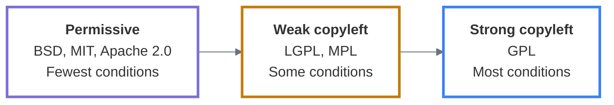

:::::::::::::::::::::::::::::::::::::: questions

- What must every open source license allow, no matter which one you pick?
- What does a permissive license ask of people who use your code, and what does a copyleft license ask instead?
- If two licenses are in the same family, does it matter which one you choose?

::::::::::::::::::::::::::::::::::::::::::::::::

::::::::::::::::::::::::::::::::::::: objectives

- State what an OSS license must allow users to do.
- State what a permissive license allows and requires, and give an example of a permissive license.
- State what a copyleft license allows and requires, and give an example of a copyleft license.
- State what a weak copyleft license allows and requires, and give an example of a weak copyleft license.

::::::::::::::::::::::::::::::::::::::::::::::::

::::::::::::::::::::::::::::::::::::: instructor

### Narrative outline: Camila (draft for the group to edit)

- Camila has decided to share all of her code.
- Her question: permissive or copyleft?
- She learns what each type asks of people who reuse her code.
- She learns which licenses UC favors, and why.

::::::::::::::::::::::::::::::::::::::::::::::::

## Open source licenses

An open source license:

- is royalty-free, meaning end users do not pay any money.
- permits the licensee (the end user) to use, copy, modify, and distribute the software.
- comes with source code made available to end users, so they can exercise those rights.

::::::::::::::::::::::::::::::::::::: callout

## "I want researchers to use this, but not companies"

This is one of the most common things researchers ask for, but it actually isn't compatible with the premise of open source. The [Open Source Definition](https://opensource.org/osd#:~:text=6.%20No%20Discrimination%20Against%20Fields%20of%20Endeavor) says a license "may not restrict the program from being used in a business."

If excluding commercial use really is a requirement, a license like [PolyForm Noncommercial](https://polyformproject.org/licenses/noncommercial/1.0.0) will do it. Researchers at academic institutions would still be able to use your code, but they couldn't build it into their own open source projects. Researchers at companies, startups, and industry labs couldn't use it at all.

::::::::::::::::::::::::::::::::::::::::::::::::

## License categories

Open source licenses fall into a spectrum. Permissive licenses sit on one side and strong copyleft licenses on the other.

| Category | What it allows | What it requires | Examples |
|---|---|---|---|
| Permissive | Any use, including in closed-source products | Usually attribution: keep the copyright and license notice | BSD, MIT, Apache 2.0 |
| Weak copyleft | Any use. Can be combined with code under other licenses | Changes to the licensed code itself stay under the same license | LGPL, MPL |
| Strong copyleft | Any use | Derivative works and modifications that you distribute use the same license | GPL |

Table: How the three license categories differ

## Permissive licenses

Examples: Berkeley Software Distribution (BSD), Massachusetts Institute of Technology (MIT), and Apache 2.0.

Permissive licenses have few requirements and are relatively easy to comply with. Typically, you are required to provide attribution. These licenses are common in research because they are simple and maximize flexibility. <!-- [KP1] comment marker from the source slide: a reviewer note, author unknown. -->

These licenses allow users to distribute your software commercially if they choose to.

At the University of California, BSD and MIT are favored over the Apache license. The Apache license requires licensors (the people or organizations that grant the license) to grant a patent license to all licensees. This could have the unintended effect of reaching into UC's patent portfolio and the work of other researchers. With patents, different people or groups can come up with the same idea independently.

## Copyleft licenses

At the other end of the spectrum are copyleft licenses. They are sometimes called viral licenses, because they require that derivative works (new works built on the original code) and modifications be licensed under the same terms as the copyleft license. This protects the openness of a project across its lifecycle.

Copyleft licenses may define what counts as a derivative work and what triggers the copyleft provision. So there are weak and strong copyleft licenses.

A weak copyleft license typically limits either the scope of what counts as a derivative work, or the trigger. For example, the GNU Lesser General Public License (LGPL) may allow you to dynamically link (use the library as a separate piece at runtime) to an LGPL library without triggering the copyleft provision. Your code that links to the library can then stay under the license of your choice.

## GNU General Public License (GPL) Versions 2 and 3

GPL 2.0 is a strong copyleft license. It would require your code to be placed under the terms of the GPL.

The UC system does not recommend GPL 3.0 for university-owned software, because its patent provisions may conflict with UC policies. If you need copyleft protection, consult your campus technology transfer office (Episode 4 explains its role) about GPL 2.0 or alternatives.

## Licenses in the same family

<!-- Draft for the expert to check. -->

Two licenses can sit in the same category and still differ on specific points. Check the actual clauses before you choose.

- BSD 2-Clause and BSD 3-Clause are both permissive. The 3-Clause version adds a condition: you may not use the names of the project or its contributors to endorse or promote products built from the code without permission.
- MIT and BSD are both short permissive licenses. Both ask users to keep the copyright and license notice.
- Apache 2.0 is also permissive. It adds an explicit patent license from contributors, which is why UC treats it differently from BSD and MIT.

::::::::::::::::::::::::::::::::::::: challenge

## Is this an open source license?

This is a real software license. Some details, including the software's name, have been changed to protect its identity.
Decide whether it qualifies as open source.

> In order to acquire access to the code sources, the recipient agrees:
>
> 1. to compile/use the XYZZY source code AS IS without modification; users however are welcome to request changes, or to contribute modifications subject to approval of the authors;
>
> 2. if the copy of the XYZZY downloaded by the authorized user is made available to third parties, to ensure that the user agreement is followed by the third parties;
>
> 3. to send a one-time email to xyzzy@example.com describing planned research using that module;
>
> 4. prior to publication, to email a draft of the article/letter/note to xyzzy@example.com; and
>
> 5. to include in published results or presentations the proper code name(s) and appropriate references.

Hint: focus on the first two clauses.

:::::::::::::::::::::: solution

No.
Clause 1 (especially) violates the permission to modify the software and to distribute copies of your modified version to others.
Clause 2 requires that if you distribute copies of the *unmodified* original, it is under the same license terms.

Why might someone have felt clauses like these were necessary to include in their software license?
Perhaps they have had problems in the past with users distributing modified code with errors that they felt reflected poorly on the original code.
Or perhaps they want to impose some measure of quality control over modifications.

A possible alternative would be to include a requirement that derivatives must be clearly distinguished from the original (for example, with a different name).
Some open source licenses include such clauses.

:::::::::::::::::::::::::::::::

::::::::::::::::::::::::::::::::::::::::::::::::

This exercise is adapted from the "What is Open Source?" episode of [Software Licensing](https://intersect-training.org/software-licensing/) (INTERSECT) by David E. Bernholdt, Lauren E. Milechin, Dave Rumph, Michael A. Heroux, and James Willenbring, licensed under [CC BY 4.0](https://creativecommons.org/licenses/by/4.0/).
Changes: the introduction and the solution are reworded, the solution refers to the permissions listed earlier in this episode instead of the four freedoms, and the discussion questions are left out.

:::::::::::::::::::::::::::::::::::::: challenge

## Challenge: sort the licenses

Put each license in one category: permissive, weak copyleft, or strong copyleft.

MIT, GPL 2.0, LGPL, BSD 3-Clause, MPL, GPL 3.0

::::::::::::::::::::::::::::::: solution

- Permissive: MIT and BSD 3-Clause.
- Weak copyleft: LGPL and MPL.
- Strong copyleft: GPL 2.0 and GPL 3.0.

::::::::::::::::::::::::::::::::::::::::::::::::

::::::::::::::::::::::::::::::::::::::::::::::::

:::::::::::::::::::::::::::::::::::::: challenge

## Challenge: can the company use it?

A company asks to include Camila's analysis scripts in a closed-source product that it sells. Which licenses would let the company do this without sharing its own source code? Choose all that apply.

- A. MIT
- B. BSD 3-Clause
- C. GPL 2.0
- D. GPL 3.0

::::::::::::::::::::::::::::::: solution

<!-- Draft answer for the group to check. An expert should confirm the wording. -->

**A and B.** MIT and BSD 3-Clause are permissive. The company keeps the copyright and license notice, and it can distribute the product commercially. GPL 2.0 and GPL 3.0 are strong copyleft. If the company distributes a product built on GPL code, it must share the source under the same license.

::::::::::::::::::::::::::::::::::::::::::::::::

::::::::::::::::::::::::::::::::::::::::::::::::

:::::::::::::::::::::::::::::::::::::::::::::::::::::::::::::::::::: instructor
## If you're teaching in a university context

Different universities default to different licenses, and learners may arrive having been told "use this one" without being told why. The UC often prefers BSD-3-Clause, and the license comparison earlier in this episode explains why.

Whatever the local default, the answer always ends the same way: **check with your technology transfer office.** Say that explicitly. An open source program office (OSPO) can explain the tradeoffs; the institution makes the call.

:::::::::::::::::::::::::::::::::::::::::::::::::::::::::::::::::::::::::::::::

::::::::::::::::::::::::::::::::::::: keypoints

- An open source license must let anyone use, study, change, and share the software, for any purpose, including commercial use.
- Permissive licenses (MIT, BSD, Apache) let others reuse the code almost any way they like, including in closed-source products, as long as they keep the copyright and license notice.
- Copyleft licenses (GPL) also allow any use, but anyone who distributes a modified version must share its source under the same license.
- Weak copyleft licenses (LGPL and Mozilla Public License, MPL) apply that rule only to the licensed code itself, so it can be combined with code under other licenses.
- Licenses in the same family still differ on specific points, like patents and the use of contributors' names, so check the actual clauses before choosing.
- Your institution's technology transfer office makes the final call.

::::::::::::::::::::::::::::::::::::::::::::::::

