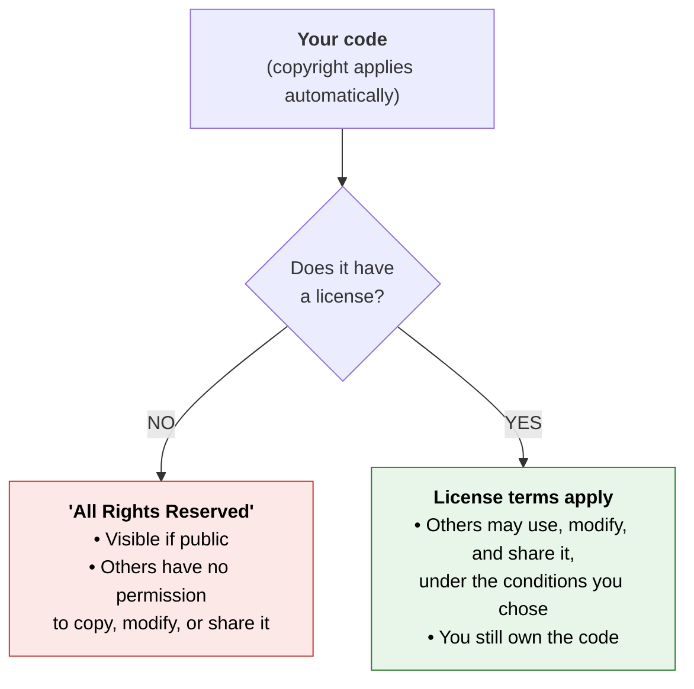

:::::::::::::::::::::::::::::::::::::: questions 

- What is an open source software license?
- Why should I add a license to my software?

::::::::::::::::::::::::::::::::::::::::::::::::

::::::::::::::::::::::::::::::::::::: objectives

- Explain what an open source software license is
- Explain how a license is related to copyright and IP laws
- Articulate the implications of not applying a license to a software project

::::::::::::::::::::::::::::::::::::::::::::::::

To start our conversation about Open Source Software (OSS) licensing, let's find out what we already know and what we only *think* we know.
Decide whether each statement is a myth or a fact.
Don't worry about getting them right; we'll revisit each one as the episode unfolds.

::::::::::::::::::::::::::::::::::::: instructor

### Notes for the Myth or Fact opener

This challenge is a pre-assessment.
Its purpose is to surface what learners already believe, not to teach the answers.

- Allow about 2 minutes for learners to answer individually, then about 4 minutes of discussion.
    A show of hands or a poll works well for each statement.
    Note the spread of answers; it tells you which parts of the episode to emphasize.
- Keep the tone low-stakes.
    Remind learners that these statements are meant to be tricky and that being unsure is a perfectly good starting point.
- Reveal the answers briefly, then resist the urge to explain everything now.
    Each statement is unpacked in the sections that follow, so you can say "we'll see why in a few minutes."
- Statement 1 is the most commonly believed myth. If someone chose "Fact", ask what they think happens to code posted publicly with no license, and then park the question until the "What happens if you don't add a license?" section.
- Statement 3 often surfaces confusion between *ownership* and *permissions*. Note it and return to it in the ownership discussion below.
- Learners may ask "who holds the copyright if I wrote the code for my job or studies?" Acknowledge that it's a great question, say it depends on employer and institutional policy, and save it for the copyright section and its "Not legal advice" callout.

::::::::::::::::::::::::::::::::::::::::::::::::

::::::::::::::::::::::::::::::::::::: challenge

## Myths and Facts about Open Source Software (OSS)

Based on your previous knowledge, mark each statement as a Myth or a Fact.

1. If you post your code publicly on the internet, it automatically becomes Open Source.
2. An open source license is essentially a legal "permission slip" from the creator.
3. An open source license means I am giving away my ownership of the code.

:::::::::::::::: solution

1. Myth. Default copyright/IP law applies; public does not mean permission.
2. Fact. An OS license tells users exactly what they are allowed to do with the intellectual property.
3. Myth. A license does not give away ownership. It is simply a legal document where you (the owner) grant specific permissions to other people to use your code.

:::::::::::::::::::::::::
:::::::::::::::::::::::::::::::::::::::::::::::

Let's look at why each of these statements is a myth or a fact, starting with the basics.

## Starting point: what is open source software (OSS)?

OSS is software whose source code is made available so that other people can read it, use it, modify it, and share it.
Many tools you probably already rely on (Linux, Python, R, Git) are open source.

But "the code is visible" and "the code is open source" are not the same thing.
What makes software open source is the permission attached to the code, and that permission is granted through a **license**.

## What is an open source license?

An open source license is a legal document that comes with your software and tells other people what they are allowed to do with it.
Think of it as a permission slip from the creator to everyone else.

A license typically answers questions like:

- Can I use this software (including for commercial purposes)?
- Can I modify it?
- Can I share it, with or without my changes?
- Do I need to credit the original author?
- Do I have to share my changes under the same terms?

Two things to keep in mind:

- A license does not transfer ownership.
    You remain the owner of your code.
    You are granting others specific, non-exclusive permissions, which means you can still use your code yourself and even offer it under different terms to other people.
- A license is attached to the work itself, usually as a `LICENSE` file in the root of your project, so the permissions travel with the code wherever it goes.

::::::::::::::::::::::::::::::::::::: callout

### Not legal advice

This lesson explains general concepts to help you make informed decisions. It is not legal advice. For specific situations, such as employer or university IP policies, funder requirements, or commercial products, consult your institution's legal or technology transfer office.

::::::::::::::::::::::::::::::::::::::::::::::::

## How does a license relate to copyright?

Copyright law (and intellectual property law more broadly) is the reason licenses exist.

When you create something original, including software, *copyright applies automatically*.
You don't need to register it or add a notice. By default, the law says:

- You, the creator (or your employer or institution, depending on your situation), hold the exclusive rights to copy, modify, and distribute the work.
- Everyone else is *not* allowed to do those things without your permission.

This default is often called **"All Rights Reserved"**. It applies to your code even when the repository is public on GitHub, GitLab, or Bitbucket. Adding a license changes what happens next:

**A license is the mechanism for changing the defaults permissions**. It is you, the rights holder, saying: "Here is what you may do with my work, and under what conditions."

## What happens if you don't add a license?

It's tempting to think: *"I put my code on GitHub, so anyone can use it."*
Legally, that's not true. (Sound familiar? It's the first myth from the challenge.)

If a project has no license, default copyright applies: all rights are reserved by the author.
Other people generally have no legal permission to use, modify, or redistribute your code, even though they can see it.

(Platforms such as GitHub let people view and fork public repositories under their terms of service, but that is not the same as permission to reuse your code in their own work.)

::::::::::::::::::: spoiler

### Example scenario: the accidental trap

A researcher writes an efficient data-parsing script and uploads it to GitHub with a README but no license file.

A teammate at another institution finds it, copies it into a multi-institutional research pipeline, and publishes a paper.
A year later, a company wants to integrate that pipeline into a medical diagnostic tool.

During legal review, the lawyers notice the original script has no license.
Because no permissions were ever granted:

- The company cannot safely use the pipeline.
- The institutions may have to audit their repository and remove or rewrite the script.
- The work stalls until the original author is found and agrees to add a license, or the script is replaced.

Notice that nobody acted in bad faith.
The author wanted to share and the teammate wanted to collaborate.
The missing license created the problem, and it only surfaced a year later, when it was harder and more expensive to fix.

:::::::::::::::::::::::::::::

In general, *without* a license:

| Who | What happens |
|---|---|
| Users | Unsure if they can use the code, so many (especially companies and institutions) simply won't |
| Contributors | Can't be sure their contributions can be legally included and shared |
| You, the author | Your work is less likely to be reused, cited, or improved |

::::::::::::::::::::::::::::::::::::: instructor

### Notes for the think-pair-share challenge

- Collect the "Think" answers with a quick show of hands or poll before pairing, so you can see the spread of misconceptions.
- Expect some learners to pick **D**. 
    Use it to show that attribution and permission are different things.
- Connect back to the accidental trap example:
    the think-pair-share looks at the problem from the user's side, while the case study looked at it from the author's side. 
    Ask: "At what point could the trap have been prevented, and by whom?"
- During "Share", ask pairs to name a concrete message they would send to the author. 
    This makes the implications of having no license practical.
- If the group finishes early, ask:
    "What if the author never replies?"
    This leads naturally into why you should license your own work, and into the choice-of-license episodes that follow.

::::::::::::::::::::::::::::::::::::::::::::::::

::::::::::::::::::::::::::::::::::::: challenge

## You found code with no license: think, pair, share

**Scenario:** You are a researcher and you find a GitHub repository with a script that does exactly what you need. The README says "Feel free to use this!", but there is no `LICENSE` file anywhere in the project. You want to adapt the script for your own analysis and include it in a public repository that accompanies your paper.

**Think (2 min):** On your own, choose the answer you think is best. Don't discuss yet.

What is the legal situation?

- A. The code is public, so I can use, modify, and share it however I like.
- B. I can use and modify it, but I'm not allowed to redistribute it.
- C. It's unclear whether I have permission, so I should ask the author before reusing it.
- D. I can reuse it freely as long as I give the author credit.

**Pair (3 min):** Compare answers with a partner. If you chose differently, try to convince each other. Then, together, answer:

1. What are the possible risks to you and your project if you reuse the code anyway?
2. What are two things you could do to resolve the situation?
    (For example, who could you contact, and what exactly would you ask for?)

**Share (5 min):** Be ready to report your pair's conclusions to the group.

:::::::::::::::: solution

**Best answer: C.**

- **A** is the myth from the opening challenge (Statement 1).
    Public does not mean permission, because default copyright still applies.
- **B** invents a partial permission.
    Without a license, no permissions are granted at all, so "use but don't share" has no more legal basis than "share freely".
- **D** confuses crediting an author with having permission.
    Attribution is only a condition if a license grants permission in the first place.
- A friendly line in the README is not a substitute for a license.
    It is informal and ambiguous (Who may use it? For what? Can it be modified or redistributed?).

**Possible risks:** a legal or reputational problem for you or your institution, a paper or repository that has to be retracted or rewritten later, and an unclear status for anyone who reuses your work.

**Possible actions:**

- Open an issue (or email the author) asking them to add a license, ideally suggesting a specific one.
- Ask the author for explicit written permission for your intended use.
- Look for an alternative tool that does have a license.
- Write your own implementation from scratch, without copying the original code.

:::::::::::::::::::::::::

::::::::::::::::::::::::::::::::::::::::::::::::

## Looking ahead

Now that you know why a license matters, the next questions are:

- What are the most common open source licenses, and what do they allow?
- Which license should I choose? Licenses differ in how much freedom they give and what they require in return. Some are **permissive** (few conditions) and others are **copyleft** (conditions that keep derivative work open).
- How do I choose and apply a license to my own project, and justify the choice?
- What happens when the licenses of the libraries your project depends on don't fit together?

We'll tackle these in the next episodes.

::::::::::::::::::::::::::::::::::::: keypoints

- An open source license is a legal document that tells others what they can and cannot do with your software; think of it as a permission slip from the creator.
- Copyright applies automatically to original work, including code, and by default reserves all rights to the author ("All Rights Reserved").
- Making code public does not make it open source. Without a license, others have no clear legal permission to use, modify, or share it.
- A license does not give away ownership; the author keeps ownership and grants specific, non-exclusive permissions.
- Adding a license makes your work easier to reuse, contribute to, and trust.

::::::::::::::::::::::::::::::::::::::::::::::::
